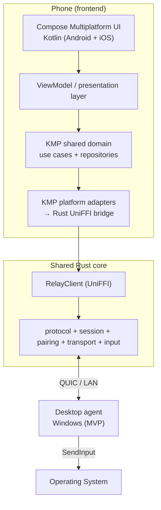
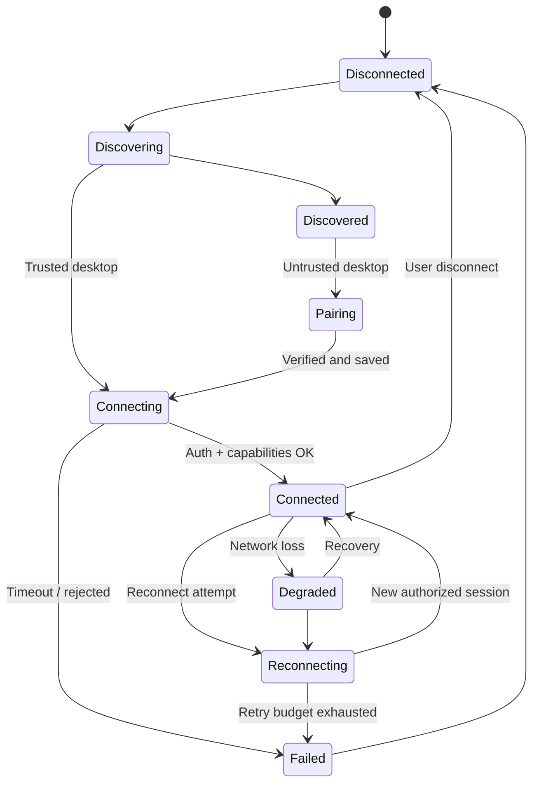

# Frontend Design — Phone Input Relay

> **Status:** Design document (proposed)\
> **Targets:** Android first (Jetpack Compose), iOS second (Kotlin Multiplatform + Compose Multiplatform), Windows desktop agent first\
> **Bridge:** Kotlin Multiplatform (KMP) + UniFFI to shared Rust core\
> **Transport:** QUIC over LAN (mDNS discovery, QR pairing)

## 1. Overview

The phone is the **input device**, not a screen stream. The frontend generates semantic input events (pointer deltas, clicks, keys, text, voice transcription, media commands) and sends them to a desktop agent over an authenticated QUIC connection. The desktop agent injects them into the OS via native input APIs.

**Non-goals:**
- Screen mirroring / remote desktop
- Raw microphone audio streaming over QUIC
- Automatic clipboard synchronization without explicit user action

## 2. Architecture

### 2.1 Layered diagram



### 2.2 Ownership boundaries

| Layer | Responsibilities |
|-------|------------------|
| Native UI (Compose Multiplatform) | Touch sensing, gestures, text editing, voice recognition, clipboard access, permissions, haptics |
| KMP shared domain | Presentation state, device list, pairing UX coordination, settings, use cases, input-command mapping, reconnect policy |
| KMP platform adapters | Platform-specific discovery, secret store, relay client implementation |
| Rust UniFFI bridge | QUIC client, codec, crypto identity, protocol/session machinery |
| Shared Rust core | Protocol, transport, session, pairing, input state, diagnostics |

**Rule:** Do not route native mobile permissions through Rust. Do not implement a second wire protocol or QUIC stack in Kotlin.

### 2.3 Source layout (proposed)

```text
mobile/
├── rust-bridge/              # Rust cdylib / staticlib, UniFFI UDL
│   ├── Cargo.toml
│   ├── src/
│   │   ├── lib.rs
│   │   ├── client.rs
│   │   ├── commands.rs
│   │   ├── callbacks.rs
│   │   └── errors.rs
│   └── tests/
├── shared/                   # KMP Gradle module (common + androidMain + iosMain)
│   ├── build.gradle.kts
│   └── src/
│       ├── commonMain/kotlin/dev/remkey/
│       │   ├── domain/
│       │   │   ├── model/
│       │   │   ├── repository/
│       │   │   └── usecase/
│       │   ├── data/
│       │   │   ├── DeviceRepositoryImpl.kt
│       │   │   └── SessionRepositoryImpl.kt
│       │   ├── presentation/
│       │   │   ├── DeviceListViewModel.kt
│       │   │   └── TouchpadViewModel.kt
│       │   └── relay/
│       │       ├── RelayClient.kt
│       │       ├── RelayCommand.kt
│       │       └── RelayConnectionState.kt
│       ├── androidMain/kotlin/dev/remkey/platform/
│       │   ├── AndroidRelayClient.kt
│       │   ├── AndroidDiscovery.kt
│       │   └── AndroidSecretStore.kt
│       └── iosMain/kotlin/dev/remkey/platform/
│           ├── IosRelayClient.kt
│           ├── IosDiscovery.kt
│           └── IosSecretStore.kt
├── composeApp/               # Shared Compose Multiplatform UI (Android + iOS)
│   └── src/commonMain/kotlin/
│       ├── screens/
│       │   ├── DeviceListScreen.kt
│       │   ├── PairingScreen.kt
│       │   ├── TouchpadScreen.kt
│       │   ├── KeyboardScreen.kt
│       │   └── SettingsScreen.kt
│       └── components/
├── androidApp/
│   ├── build.gradle.kts
│   └── src/main/
│       ├── AndroidManifest.xml
│       └── kotlin/dev/remkey/
│           ├── MainActivity.kt
│           ├── service/RelayForegroundService.kt
│           └── platform/{VoiceInput.kt, Clipboard.kt, Haptics.kt}
├── iosApp/
│   ├── RemKey.xcodeproj
│   └── RemKey/
│       ├── RemKeyApp.kt            # Kotlin/Native entry point, Compose UI host
│       └── Platform/{VoiceInput.kt, Clipboard.kt}
└── bindings/                 # Generated UniFFI artifacts
    ├── android/              # Kotlin + .so
    └── ios/                  # Kotlin + .framework (Kotlin/Native)
```

## 3. Design Principles

1. **Semantic input UI** — The phone UI produces semantic intents (MouseMove, KeyDown, Text, Composition), not platform-specific events.
2. **Control plane separate from data plane** — Discovery, pairing, and settings screens are visually distinct from the active input screens (touchpad, keyboard, voice).
3. **Transport independence** — UI does not reference QUIC directly; it speaks to `RelayClient` over the UniFFI boundary.
4. **Text is first-class** — Keyboard text and voice text converge on the same text-input composition flow.
5. **OS-specific logic stays at the edge** — Platform adapters handle discovery, secret storage, permissions; shared domain stays platform-agnostic.
6. **Explicit input-state safety** — Disconnects must never leave stuck keys, buttons, modifiers, drags, or compositions. UI reflects this state.
7. **Capability-aware UI** — The phone UI adapts to negotiated capabilities (hide voice if desktop doesn't support it).
8. **No silent trust-on-first-use** — Pairing requires explicit QR ceremony; unknown devices are rejected unless pairing is open.
9. **Local high-frequency processing** — Touch gestures are classified, coalesced, and scheduled on the phone before crossing the FFI boundary.
10. **Extensibility** — Adding iOS, macOS, Linux, or Bluetooth HID should not require rewriting the semantic event model or UI contracts.

## 4. Connection State Machine



Every transition into `Disconnected` triggers input-state reset (release held keys, buttons, modifiers, cancel drag, terminate composition).

### 4.1 State-to-UI mapping

| State | UI indication | User actions available |
|-------|---------------|------------------------|
| Disconnected | "Disconnected" / offline indicator | Scan, enter IP, select paired device |
| Discovering | "Scanning..." spinner | Cancel scan |
| Discovered | Device list with names + status | Select device, pair, manual IP |
| Pairing | Pairing ceremony screen | Scan QR, confirm fingerprint, enter secret |
| Connecting | "Connecting..." progress | Cancel |
| Connected | Active input screens available | Touchpad, keyboard, voice, clipboard |
| Degraded | "Connection degraded" warning | Wait, reconnect, disconnect |
| Reconnecting | "Reconnecting..." indicator | Cancel |
| Failed | Error message with reason | Retry, forget device, disconnect |

## 5. UI Screens

### 5.1 Device List

**Purpose:** Discover candidate desktops and select one to connect to.

**Elements:**
- Floating action button: scan / refresh
- List of discovered devices (name, address, status: paired / unpaired / unknown)
- Paired devices section (from trust store)
- "Add device manually" → IP entry dialog
- QR scan button (to read desktop QR pairing code)
- Connection state chip per device

**States:** empty, scanning, populated, error

### 5.2 Pairing

**Purpose:** Complete the QR pairing ceremony to establish trust.

**Flow:**
1. Desktop displays QR code (endpoint, cert fingerprint, one-time secret)
2. Phone scans QR or user enters details manually
3. Phone shows desktop name + fingerprint for verification
4. User confirms pairing → desktop accepts or rejects
5. Success: device saved to trust store; failure: show reason, offer retry

**Security UX:**
- Show full fingerprint (or at least first 12 hex chars) for user verification
- Never auto-trust on first use
- Pairing window is time-limited (default 120 s) and single-use

### 5.3 Touchpad

**Purpose:** Pointer movement, clicks, scroll.

**Elements:**
- Large touch surface (fills screen or with controls above/below)
- Left / right / middle button taps or dedicated buttons
- Two-finger scroll zone
- Sensitivity slider (persisted)
- Gesture hints (tap = click, double-tap, drag, pinch)

**Processing pipeline (on phone):**
```
Raw Touch Events
    ↓
Gesture Classifier (pan / pinch / scroll / tap)
    ↓
Velocity Estimation (per pointer)
    ↓
Acceleration Curve (Windows-like)
    ↓
Movement Coalescer (merge small consecutive deltas)
    ↓
60–120 Hz Scheduler
    ↓
MouseMove / MouseButton / Scroll events via RelayClient
```

**Critical:** Coalesce movement before crossing the FFI boundary. Do not send every raw touch sample as a separate UniFFI call.

### 5.4 Keyboard

**Purpose:** Text input and physical key events.

**Two paths:**

1. **Text input** (committed Unicode text):
   - Phone keyboard / IME → committed text → `Text` event → desktop text injection
   - Supports non-ASCII and IME composition

2. **Physical key transitions** (`KeyDown` / `KeyUp`):
   - For shortcuts where physical key semantics matter (Ctrl+C, Alt+Tab, etc.)
   - Modifier state tracked per session

**Elements:**
- QWERTY layout (platform-appropriate)
- Modifier keys (Ctrl, Shift, Alt, Meta / Cmd)
- Function keys, navigation, media keys
- Shift toggle, caps lock indicator
- Text field preview (optional)

**Rule:** Never replay stale key-down events after reconnect.

### 5.5 Voice

**Purpose:** Speech-to-text input on the desktop.

**Pipeline:**
```
Microphone
    ↓
Audio Capture (native: SpeechRecognizer / Speech framework)
    ↓
Voice Activity Detection
    ↓
Speech Recognition
    ↓
Partial Transcript → CompositionUpdate
Final Transcript → CompositionCommit
    ↓
Text Input Engine (shared with keyboard)
    ↓
RelayClient → Desktop
```

**Elements:**
- Microphone button (press-to-hold or toggle)
- Live partial transcript display
- Final transcript confirmation
- Permission handling (microphone)
- Network-offline handling (recognize locally if supported)

**Rule:** Raw microphone audio does not traverse QUIC. Only committed text / composition events cross the bridge.

### 5.6 Clipboard

**Purpose:** Send clipboard text from phone to desktop (MVP one-way).

**Elements:**
- Text input area or "Send current clipboard" button
- Permission grant dialog (one-time / this session / always / disabled)
- Size limit indicator
- Warning about sensitive content

**Rule:** Clipboard is privileged. Not active merely because a device is paired. No automatic background harvesting.

### 5.7 Settings

**Purpose:** Configure connection, input behavior, and paired devices.

**Elements:**
- Paired device management (forget, rename, view fingerprint)
- Touchpad sensitivity
- Keyboard repeat settings (future)
- Voice language / engine selection
- Diagnostics toggle
- About / version / protocol version

### 5.8 Diagnostics

**Purpose:** Observability for debugging connection and input latency.

**Elements:**
- Connection: status, transport, RTT, jitter, packet loss, bytes sent/received
- Input: touch Hz, sent Hz, coalesced %, dropped
- Desktop: decode time, injection time
- State: held keys, held buttons, modifiers, composition active/inactive

**Goal:** Distinguish phone processing + network latency + desktop processing + OS injection latency.

## 6. State Management

### 6.1 Repository layer

- `DeviceRepository` — discovered devices, paired devices, selected device
- `SessionRepository` — active connection owner, connection state, capabilities

**Rule:** A Composable must not own the transport. The session repository/service is the single connection owner, outliving UI recompositions and configuration changes.

### 6.2 ViewModels

- `DeviceListViewModel` — scan, device list, pairing initiation
- `TouchpadViewModel` — gesture → command mapping, sensitivity
- `KeyboardViewModel` — key state, text input
- `PairingViewModel` — QR scan, secret entry, pairing result
- `SettingsViewModel` — configuration, device management
- `DiagnosticsViewModel` — metrics display

### 6.3 Connection lifecycle ownership

Android: lifecycle-aware Compose + ViewModels; foreground service only when justified (background operation). iOS: Compose Multiplatform UI with ViewModels; foreground sessions first; background suspension treated as normal disconnect/recovery.

## 7. Navigation

- Bottom navigation (Compose Multiplatform, shared across Android and iOS) between: Device List, Touchpad, Keyboard, Voice, Settings
- Pairing as a modal / full-screen flow triggered from Device List
- Diagnostics accessible from Settings or as an overlay
- Deep link support for pairing (future)

## 8. Rust Bridge Contract

### 7.1 Kotlin-facing API

```kotlin
interface RelayClient {
    val state: StateFlow<RelayConnectionState>
    suspend fun connect(target: PairedDevice)
    suspend fun send(command: RelayCommand)
    suspend fun disconnect()
}

sealed interface RelayCommand {
    data class PointerDelta(val dx: Float, val dy: Float) : RelayCommand
    data class Scroll(val dx: Float, val dy: Float) : RelayCommand
    data class MouseButton(val button: Button, val pressed: Boolean) : RelayCommand
    data class Key(val key: Key, val pressed: Boolean) : RelayCommand
    data class CommitText(val text: String) : RelayCommand
    data class Media(val action: MediaAction) : RelayCommand
}

sealed interface RelayConnectionState {
    object Disconnected : RelayConnectionState
    object Discovering : RelayConnectionState
    data class Discovered(val devices: List<DiscoveredDevice>) : RelayConnectionState
    object Pairing : RelayConnectionState
    object Connecting : RelayConnectionState
    object Connected : RelayConnectionState
    object Degraded : RelayConnectionState
    object Reconnecting : RelayConnectionState
    data class Failed(val reason: String) : RelayConnectionState
}
```

These are domain-level examples; map them explicitly to `pir_protocol::InputEvent` and add protocol versioning before modifying the wire schema.

### 7.2 Rust UniFFI boundary

Expose a long-lived Rust client object with high-level methods:

```rust
pub struct RelayClient {
    // Owns a connection task, command channel, and state notifier.
}

impl RelayClient {
    pub async fn connect(&self, target: PairedTarget) -> Result<(), RelayError> { todo!() }
    pub fn enqueue_pointer_delta(&self, dx: f64, dy: f64) -> Result<(), RelayError> { todo!() }
    pub async fn disconnect(&self) -> Result<(), RelayError> { todo!() }
}
```

**Guidelines:**
- Avoid an FFI crossing for every raw touch sample; aggregate in Kotlin and/or Rust.
- A bounded Rust channel decouples UI dispatch from QUIC I/O.
- Use UniFFI-supported records/enums/errors; avoid exposing Tokio internals.
- Deliver connection changes via supported callbacks or observable adapter state.
- Test bridge cancellation, lifecycle, and object destruction.

### 7.3 Platform binding details

**Android:** Compile Rust `cdylib` for supported ABIs (`arm64-v8a` first), package `.so` libraries in the APK/AAB, integrate generated UniFFI Kotlin/JNA bindings.

**iOS:** Build Rust for iOS device/simulator targets, produce a Kotlin/Native-compatible library (`.framework`) with UniFFI Kotlin bindings. KMP common code calls the Rust bridge directly from `iosMain`. No Swift UniFFI bindings needed; Kotlin/Native interops with the Rust library directly.

## 9. Platform-Specific Details

### 9.1 Android

- Jetpack Compose UI
- Foreground service for background operation (only when justified, compliant with service-type and notification requirements)
- Permissions: microphone (voice), Bluetooth (discovery/HID), network
- Android Keystore for credential storage
- `androidMain` platform adapters: `AndroidRelayClient`, `AndroidDiscovery`, `AndroidSecretStore`
- Handle network changes, screen rotation, battery behavior

### 9.2 iOS

- Compose Multiplatform UI (shared Kotlin code with Android)
- Kotlin/Native entry point hosting Compose UI
- Native permissions, clipboard, speech, Bonjour in iOS-specific code
- No persistent background QUIC connection assumed; background = disconnect/recovery
- `iosMain` platform adapters: `IosRelayClient`, `IosDiscovery`, `IosSecretStore`
- Speech framework for voice input
- iOS Keychain for credential storage

### 9.3 Shared (KMP common)

- Domain models, use cases, ViewModels
- Shared Compose Multiplatform UI (`composeApp`) — one UI codebase for Android and iOS
- Platform-agnostic `RelayClient` interface and `RelayCommand` sealed interface

## 10. Input Flows

### 10.1 Pointer movement

```
Compose Touchpad → Gesture Controller → KMP RelayClient → Rust Mobile Core → QUIC → Desktop Agent → Native OS
```

Movement policy: begin with reliable ordered movement or an explicitly cumulative datagram scheme. Keep key/button transitions reliably ordered; do not allow coalescing to cross a click boundary.

### 10.2 Keyboard

- Distinguish physical key transitions (`KeyDown`, `KeyUp`) from committed Unicode text.
- Compose text fields and Android IME send committed text; key combinations use explicit key transitions.
- Handle composition/IME and non-ASCII without assuming US keyboard layout.
- Desktop agent tracks pressed state per authenticated session and releases held keys/buttons when session ends.

### 10.3 Clipboard

MVP: explicit user action to send clipboard text to desktop. Add desktop-to-phone later after permissions and UX are designed. Set size limits, handle MIME types, prevent synchronization loops.

### 10.4 Voice

Android `SpeechRecognizer` / iOS Speech framework → committed text → `CommitText` → Rust protocol → desktop text injection. Handle recognition permissions and transient results separately from committed text. Speech recognition is native to each mobile OS; the Compose Multiplatform UI displays partial/final transcripts.

### 10.5 Media keys

Map UI actions to semantic consumer-key commands (play/pause, next/previous, volume). Desktop adapters translate to OS-native key events.

## 11. Discovery, Pairing, and Trust

### 11.1 Discovery

1. Desktop advertises on LAN via mDNS/DNS-SD (`_phone-input-relay._udp.local.`), or displays QR code with endpoint info.
2. Phone discovers candidates and shows friendly names.
3. Discovery information is untrusted until authenticated pairing.
4. User selects desktop and completes verified pairing ceremony.
5. Manual IP entry as development fallback.

Android NSD and iOS Bonjour/network permissions are platform-specific.

### 11.2 Trust model

- Persist desktop identity and device-specific pairing record.
- Bind TLS server identity to trusted pairing (certificate/public-key pinning).
- Authenticate phone to desktop, not merely desktop to phone.
- Bind authenticated peer to session authorization and permitted capabilities.
- Protect mobile credentials using Android Keystore / iOS Keychain.
- Pairing and revocation enforceable by desktop agent, not merely shown in UI.
- Restrict listening interfaces; never expose unauthenticated input injection.
- Plan identity rotation, revocation, replay protection, and rate limits.

### 11.3 QR payload (PairingInfo, version 2)

```json
{
  "version": 2,
  "name": "Desktop name",
  "endpoints": ["192.168.1.50:8080"],
  "cert_fingerprint": "hex sha-256 of the agent certificate",
  "secret": "one-time 128-bit secret (hex)"
}
```

## 12. Security UX

- QR pairing flow with fingerprint verification display
- Trust persistence UI (paired devices list, forget option)
- Revocation UI (remove trusted device)
- Capability negotiation UI (show/hide features based on desktop support)
- Never log clipboard contents, dictated text, raw keys, or secrets
- Avoid recording sensitive event payloads in crash reports

## 13. Error Handling & Diagnostics

**Error taxonomy:** discovery error, trust failure, pairing rejected, protocol mismatch, network timeout, backpressure, permission denied, native input injection failure.

**Metrics:** connection establishment latency, authentication failures, RTT, queue depth, input dispatch latency, end-to-end event latency, dropped/coalesced movements, heartbeat timeouts, reconnect attempts, session cleanup failures.

**Observability:** Rust `tracing`; Kotlin structured logs with session correlation IDs.

## 14. Milestones & Frontend Tasks

### Phase 0 — Baseline and contracts

- Sync latest `main` after Rust core PRs
- Confirm protocol wire format, QUIC framing, session authorization
- Define single-active-controller policy
- **Exit:** Desktop Rust client and agent exchange authenticated events reliably

### Phase 1 — Android vertical slice

- Add Rust UniFFI mobile bridge
- Compile for Android ARM64; package library
- Build minimal Android Compose app
- Connect to known desktop endpoint
- Send one movement event and display connection state
- **Exit:** Real Android phone moves Windows cursor over authenticated QUIC

### Phase 2 — Usable Android MVP

- Touchpad, click, scroll, sensitivity
- Keyboard/text/shortcuts
- Discovery, QR pairing, trust persistence
- Reconnect, safe release, diagnostics
- **Exit:** Phone replaces basic mouse/keyboard for foreground use

### Phase 3 — iOS KMP rollout

- Share Compose Multiplatform UI with Android
- Prove Rust library + UniFFI Kotlin bindings on iOS (Kotlin/Native)
- Prove KMP `iosMain` adapter to the bridge
- Implement iOS discovery, permissions, speech/clipboard
- **Exit:** iPhone connects to same desktop protocol with shared Kotlin UI, no second QUIC implementation

### Phase 4 — Extended functionality

- Clipboard (explicit opt-in), voice-to-text, media controls
- Better gestures and accessibility
- Device switching and multi-controller arbitration
- Desktop macOS/Linux adapters
- **Exit:** Cross-platform feature parity and tested OS-specific behavior

## 15. Open Questions

1. Does merged Rust PR #1 provide mutual client authentication or only server certificate pinning?
2. What exact frame/version schema is on `main`?
3. How are cumulative pointer deltas and datagram loss handled?
4. Is device identity managed by Rust or signed using platform-backed keys?
5. Can the desktop accept multiple paired connections while permitting only one active controller?
6. Which Android ABI / minimum SDK and iOS deployment target are supported?
7. What permissions and capability negotiation are required for clipboard, voice, and media keys?

## 16. Architectural Decision Records (ADRs)

- **ADR-F01:** Kotlin Multiplatform + Compose Multiplatform shares domain, presentation, and UI logic across Android and iOS; platform APIs remain native in `androidMain` / `iosMain`.
- **ADR-F02:** UniFFI exposes coarse-grained commands, not raw Tokio or QUIC handles.
- **ADR-F03:** Desktop enforces authentication and authorization before input injection.
- **ADR-F04:** One active controlling device for the MVP.
- **ADR-F05:** Reliable ordered delivery for stateful key/button events; pointer transport defines loss semantics.
- **ADR-F06:** Foreground-first mobile lifecycle, background support separately evaluated.
- **ADR-F07:** Android first; iOS uses the same Compose Multiplatform UI and KMP shared logic, validated against iOS Rust/KMP interoperability.
